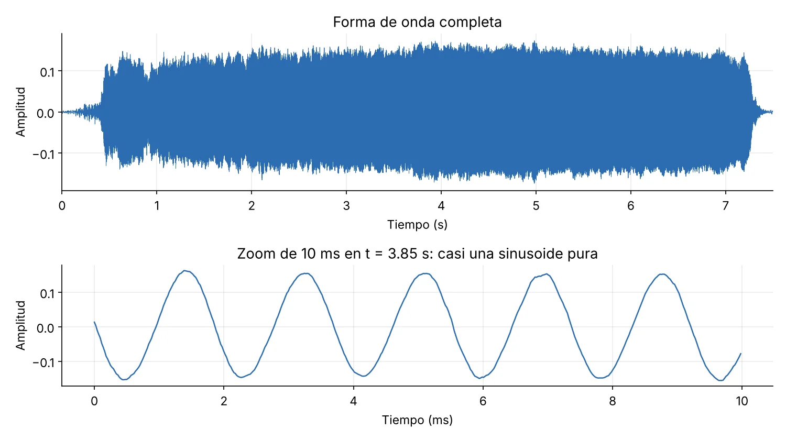
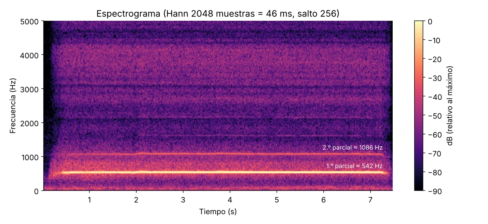
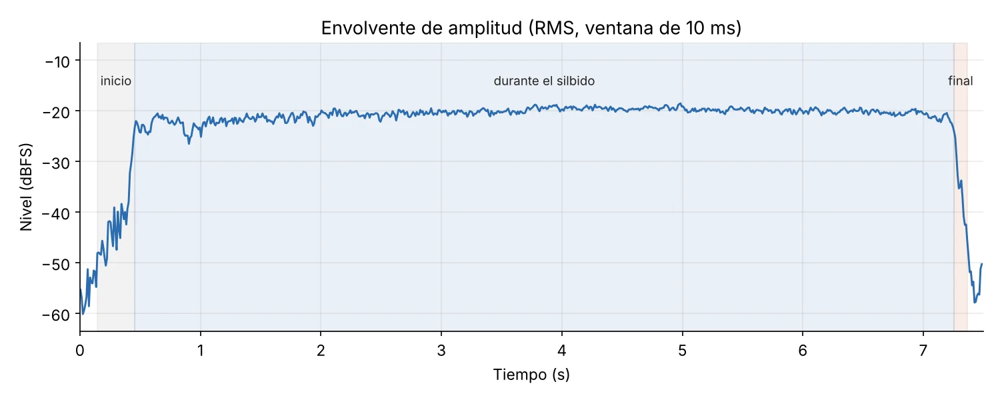
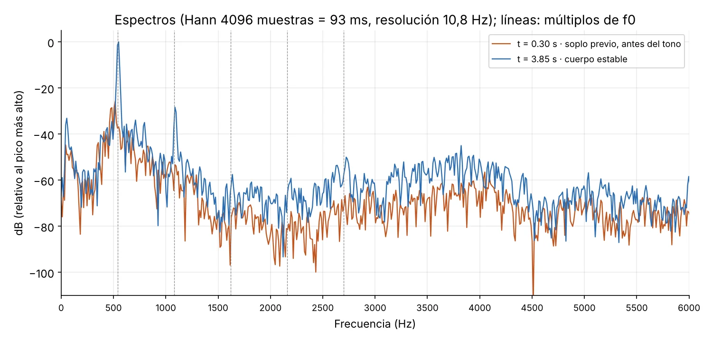
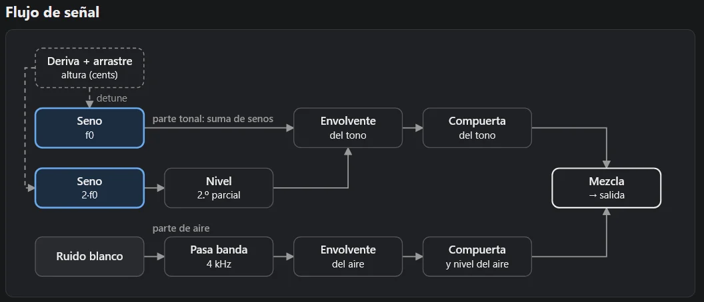
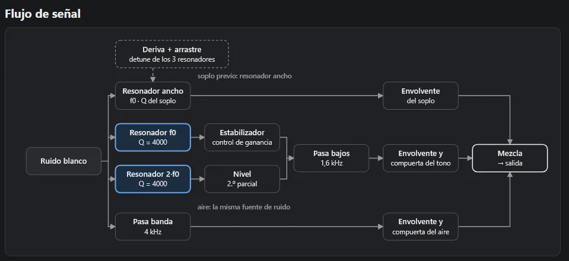
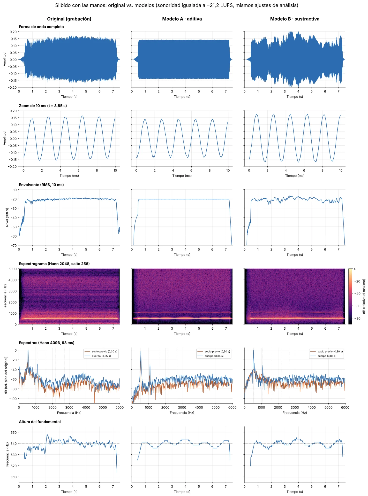
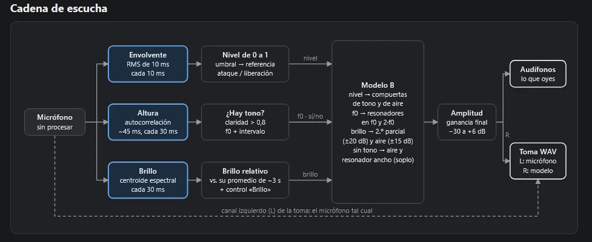

Un silbido hecho con las manos, analizado y reconstruido con dos métodos de síntesis (aditiva y sustractiva) y luego tocado en vivo por el mismo silbido.

> Esta entrada también está como página propia, con todos los audios y los dos modelos, en mi [carpeta del portafolio de la orquesta](https://orquestalaptopsuc.github.io/2026/portafolios/Felipe_Osorio/T2_Metodos_de_sintesis/).
{: .prompt-tip }

## Parte 1: La fuente. Cómo suena y de qué está hecha

**Grabación original: silbido con las manos**

<audio controls preload="none" style="width:100%">
  <source src="https://orquestalaptopsuc.github.io/2026/portafolios/Felipe_Osorio/T2_Metodos_de_sintesis/audio/original_silbido.wav" type="audio/wav">
  Tu navegador no puede reproducir este audio. <a href="https://orquestalaptopsuc.github.io/2026/portafolios/Felipe_Osorio/T2_Metodos_de_sintesis/audio/original_silbido.wav">Descargar</a>.
</audio>

El silbido con manos fue grabado en un cuarto amplio a unos 35cm (distancia yo – micrófono), pareciera ser un sonido armónico\[1\] el cual presenta una altura definida\[2\] (aunque un poco inestable por error humano) la cual está alrededor de un 5Do en un piano o es decir alrededor de 523.25 Hz\[3\]. En particular al utilizar las manos el timbre se ve afectado\[1\], sonando un poco más opaco o “sucio” en comparación a un silbido normal al tener acentuado, sobre todo al inicio, el sonido del viento pasando por las manos. La altura principal del sonido comienza tras un inicio en el que el aire entra a las manos mientras yo encuentro la posición perfecta para que suene, posterior a esto empieza a sonar la altura del sonido, la cual no se mantiene perfectamente constante (debido a que varía que tanto aire estoy usando) y luego finaliza desvaneciendo en poco tiempo, pero progresivamente cuando moví mis manos, pero sople un poco más.

*Disclaimer, para el análisis las siguientes gráficas fueron creadas directamente por Claude y ajustadas por mí.*

{: .shadow }
_Forma de onda completa y zoom de 10 ms en t = 3,85 s._

{: .shadow }
_Espectrograma (ventana Hann de 2048 muestras, salto de 256)._

{: .shadow }
_Envolvente de amplitud (RMS, ventana de 10 ms): inicio, durante el silbido y final._

{: .shadow }
_Espectros en t = 0,30 s (soplo previo) y t = 3,85 s (cuerpo estable)._

Con estos gráficos podemos observar que es casi un sonido sinusoidal\[4\] al observar su forma de onda\[5\] y corroborar la presencia de una parcial cercana al 5Do, en 542 Hz y de una segunda que pasa más desapercibida en 1086 Hz (casi teniendo una relación 1:2, una relación armónica\[1\]). Por lo cual podemos asegurar correctamente que es un sonido con rasgos armónicos, pero no completamente puro, por la presencia del ruido causado por el aire, observable claramente desde los 3 kHz en adelante\[1\], que es lo que le da este carácter “sucio" al sonido.

En el espectrograma\[6\] se pueden distinguir claramente las tres secciones del sonido.  
\-Inicio: En la que no estoy soplando y estoy posicionando mis manos solamente, la cual está relacionada con el espacio negro que hay al inicio. Luego empiezo a soplar, pero no estoy en la posición correcta, se observa como aparece color, pero los parciales no se marcan fuerte.

\-Durante el silbido: Intento mantener un constante del sonido con leves variaciones y se ven claramente marcados los armónicos con el ruido.

\-Final: En el cual muevo un poco mis manos antes de dejar de soplar, lo cual se puede observar al ver como dejan de estar marcados los parciales y el ruido se mantiene hasta que paro de soplar.

## Parte 2: Un sonido, dos métodos

### Modelo A · síntesis aditiva

**Modelo A: imitación del silbido**

<audio controls preload="none" style="width:100%">
  <source src="https://orquestalaptopsuc.github.io/2026/portafolios/Felipe_Osorio/T2_Metodos_de_sintesis/audio/modeloA_aditiva.wav" type="audio/wav">
  Tu navegador no puede reproducir este audio. <a href="https://orquestalaptopsuc.github.io/2026/portafolios/Felipe_Osorio/T2_Metodos_de_sintesis/audio/modeloA_aditiva.wav">Descargar</a>.
</audio>

**[Abrir el controlador del modelo A →](https://orquestalaptopsuc.github.io/2026/portafolios/Felipe_Osorio/T2_Metodos_de_sintesis/modelos/aditiva.html)**

Modelo A síntesis aditiva: En este método se utilizan dos sinusoides, la principal y su múltiplo de dos\[7\], con esto se puede obtener los dos parciales principales en el sonido. Luego para emular el aire, a un ruido blanco se le colocó un filtro pasa banda en los 4 kHz y finalmente para emular la inestabilidad del sonido se le agregó una deriva y arrastre los cuales modifican en un rango de “movimiento” la frecuencia\[3\]. Como limitación que se puede observar con este método es que aún faltan más parciales, aunque con menos volumen y se siente “vacío” (en el sentido de que faltan sonidos en comparación al original) al solo tener las dos sinusoidales como sonidos principales en las frecuencias más bajas y el ruido blanco suena muy como ruido blanco, no como un ruido natural.

{: .shadow }
_Flujo de señal del modelo A._

### Modelo B · síntesis sustractiva

**Modelo B: imitación del silbido**

<audio controls preload="none" style="width:100%">
  <source src="https://orquestalaptopsuc.github.io/2026/portafolios/Felipe_Osorio/T2_Metodos_de_sintesis/audio/modeloB_sustractiva.wav" type="audio/wav">
  Tu navegador no puede reproducir este audio. <a href="https://orquestalaptopsuc.github.io/2026/portafolios/Felipe_Osorio/T2_Metodos_de_sintesis/audio/modeloB_sustractiva.wav">Descargar</a>.
</audio>

**[Abrir el controlador del modelo B →](https://orquestalaptopsuc.github.io/2026/portafolios/Felipe_Osorio/T2_Metodos_de_sintesis/modelos/sustractiva.html)**

Modelo B, síntesis sustractiva: Se acerca más al sonido original, al punto que, si hubiera grabado con un buen micrófono y en un estudio, probablemente habría sonado muy cercano. Este modelo funciona a partir de ruido blanco, al cual se le aplican distintos filtros pasa banda, comenzando por uno que da el soplo inicial antes de que los armónicos suenen con intensidad, luego dos filtros más, de las parciales principales, uno en 1.6 kHz que limpia el audio y uno en 4 kHz que modula el ruido en el audio original. El principal problema/límite que veo en este audio es en el ajuste de db de los distintos componentes del sonido\[8\] (las parciales deberían estar un poco más bajas, es mejor que en el modelo A, pero aún no es suficiente) y en el ruido de fondo que no llega a sonar natural.

{: .shadow }
_Flujo de señal del modelo B._

### Comparación

Los tres audios con la sonoridad igualada a −21,2 LUFS, para compararlos de oído.

**Original**

<audio controls preload="none" style="width:100%">
  <source src="https://orquestalaptopsuc.github.io/2026/portafolios/Felipe_Osorio/T2_Metodos_de_sintesis/audio/comparacion/original_igualado.wav" type="audio/wav">
  Tu navegador no puede reproducir este audio. <a href="https://orquestalaptopsuc.github.io/2026/portafolios/Felipe_Osorio/T2_Metodos_de_sintesis/audio/comparacion/original_igualado.wav">Descargar</a>.
</audio>

**Modelo A**

<audio controls preload="none" style="width:100%">
  <source src="https://orquestalaptopsuc.github.io/2026/portafolios/Felipe_Osorio/T2_Metodos_de_sintesis/audio/comparacion/modeloA_aditiva_igualado.wav" type="audio/wav">
  Tu navegador no puede reproducir este audio. <a href="https://orquestalaptopsuc.github.io/2026/portafolios/Felipe_Osorio/T2_Metodos_de_sintesis/audio/comparacion/modeloA_aditiva_igualado.wav">Descargar</a>.
</audio>

**Modelo B**

<audio controls preload="none" style="width:100%">
  <source src="https://orquestalaptopsuc.github.io/2026/portafolios/Felipe_Osorio/T2_Metodos_de_sintesis/audio/comparacion/modeloB_sustractiva_igualado.wav" type="audio/wav">
  Tu navegador no puede reproducir este audio. <a href="https://orquestalaptopsuc.github.io/2026/portafolios/Felipe_Osorio/T2_Metodos_de_sintesis/audio/comparacion/modeloB_sustractiva_igualado.wav">Descargar</a>.
</audio>

Al analizar los espectros y compararlos\[6\] se confirman los aspectos descritos por encima antes, partiendo por el ruido que no se parece al ruido “natural” de la grabación, ya que a los de los modelos les falta mayor variación de db en distintos rangos de frecuencia (observable en el espectro\[6\]). A su vez como mencioné antes las dos parciales más identificables no son las únicas, hay trazas de las otras por más que no puedan observarse en el espectro claramente. La forma que se me ocurre que podrían mejorar estos modelos es añadiendo más parciales (ondas sinusoidales)\[7\] y modificando aún más el ruido blanco con más filtros. Pero en definitiva el ganador es el modelo B de síntesis sustractiva, ya que es un sonido mucho más rico en frecuencias y “variaciones” que pueden seguir pareciendo ruido blanco, pero suman a que el sonido se sienta más completo.

{: .shadow }
_Original, modelo A y modelo B con los mismos análisis y la sonoridad igualada._

## Parte 3: Más allá del original

### Modelo A

**35 s más allá: modelo A**

<audio controls preload="none" style="width:100%">
  <source src="https://orquestalaptopsuc.github.io/2026/portafolios/Felipe_Osorio/T2_Metodos_de_sintesis/audio/mas_alla_modeloA_35s.wav" type="audio/wav">
  Tu navegador no puede reproducir este audio. <a href="https://orquestalaptopsuc.github.io/2026/portafolios/Felipe_Osorio/T2_Metodos_de_sintesis/audio/mas_alla_modeloA_35s.wav">Descargar</a>.
</audio>

Modelo A: Render de 35s, el cual parte con la configuración de mi silbido.

\-5s: “Aire” al mínimo: Sonará solo las parciales principales como sinusoides.

> **Realidad y ¿por qué?** Es exactamente lo que ocurre, este sonido tiene tres componentes las dos sinusoidales y el ruido blanco\[7\], así que al eliminar el ruido quedan solo las ondas principales.
{: .prompt-info }

\-10s: “Aire” -42dB y “Altura” 1 kHz: Mucho más agudo con el ruido de fondo

> **Realidad y ¿por qué?** Es lo que ocurre, ya que restauramos el ruido de fondo y aumentamos la frecuencia de ambas parciales\[3\].
{: .prompt-info }

\-15s: Movimientos al azar de “2.º parcial” y “Altura”: Al cambiar la “Altura” cambiara que tan grave o agudo es el sonido y al cambiar el 2ndo parcial no se notara tanto el cambio.

> **Realidad y ¿por qué?** En este caso es parcialmente correcto ya que la altura si cambia qué tan grave o agudo es al modificar la frecuencia\[2,3\]. Pero la presencia o ausencia del 2ndo parcial si hace una diferencia al bajar o subir los db\[8\].
{: .prompt-info }

### Modelo B

**35 s más allá: modelo B**

<audio controls preload="none" style="width:100%">
  <source src="https://orquestalaptopsuc.github.io/2026/portafolios/Felipe_Osorio/T2_Metodos_de_sintesis/audio/mas_alla_modeloB_35s.wav" type="audio/wav">
  Tu navegador no puede reproducir este audio. <a href="https://orquestalaptopsuc.github.io/2026/portafolios/Felipe_Osorio/T2_Metodos_de_sintesis/audio/mas_alla_modeloB_35s.wav">Descargar</a>.
</audio>

Modelo B: Render de 35s, el cual parte con la configuración de mi silbido.

\-0s: “inicio de la nota” al mínimo con “centro del filtro” a 300 Hz: Comenzarán instantáneamente a sonar las parciales en comparación al original en un tono más grave.

> **Realidad y ¿por qué?** Es exactamente lo que ocurre, ya que solo se redujo el tiempo en que empieza la nota mientras se cambió la frecuencia, dando una sensación de mayor ataque.
{: .prompt-info }

\-10s: “Aire” al mínimo: Al igual que con el modelo A, sonarán las parciales principales parecidas a sinusoides.

> **Realidad y ¿por qué?** Similar a lo que ocurre, a diferencia del modelo A, no tenemos solamente una onda sinusoidal sonando, si no que el ruido blanco, que en este caso al bajar “aire” solo silenciamos la región superior del ruido, por lo cual no suena como solo dos sinusoides.
{: .prompt-info }

\-20s: Cambios en “Pureza del tono” y “Centro del filtro”: Espero que se dejen de distinguir completamente las parciales principales (al bajar la pureza al mínimo) y que el cambio en el centro no le afecte. Aparte que cuando la pureza este al máximo se parezca más a una sinusoide pura.

> **Realidad y ¿por qué?** Al disminuir la pureza del tono (más ruido), ya que hay distintos filtros sobre el ruido blanco, se sigue distinguiendo una zona con mayores amplitudes la cual se vuelve más aguda o grave al mover el filtro. Por otro lado, cuando la pureza aumenta al máximo, el ruido no se elimina completamente, pero si suena más cercano a lo que se apreció en el modelo A.
{: .prompt-info }

Los parámetros que más modifican los sonidos fueron los discutidos en esta sección, altura en el caso del modelo A, centro del filtro y pureza del tono en el caso del modelo B, aire y el volumen de la 2nda parcial. En cambio, los que menos cambios realizan (más que nada porque abarcan segmentos muy pequeños de los sonidos), son los parámetros que controlan los inicios y fines de los sonidos.

## Parte 4: El modelo tocado por la fuente

**En vivo: el modelo B tocado por mi silbido**

<audio controls preload="none" style="width:100%">
  <source src="https://orquestalaptopsuc.github.io/2026/portafolios/Felipe_Osorio/T2_Metodos_de_sintesis/audio/en_vivo_modeloB.wav" type="audio/wav">
  Tu navegador no puede reproducir este audio. <a href="https://orquestalaptopsuc.github.io/2026/portafolios/Felipe_Osorio/T2_Metodos_de_sintesis/audio/en_vivo_modeloB.wav">Descargar</a>.
</audio>

Toma estéreo: canal izquierdo, mi silbido; canal derecho, el modelo B. **[Abrir el modo en vivo del modelo B →](https://orquestalaptopsuc.github.io/2026/portafolios/Felipe_Osorio/T2_Metodos_de_sintesis/modelos/sustractiva.html)**

{: .shadow }
_Cadena de escucha del modo en vivo (modelo B)._

En este caso con este modelo, resalta más lo artificial del ruido ya que no sabe cuando voy a parar de silbar por lo que en cualquier momento que esto pare o baje la intensidad aplica ruido como fue descrito el final de mi sonido original. En esta área de igual manera imita algo bastante bien al no ser un ruido blanco constante y es que no limita que cualquier sonido que no sea un tono suene solo ruido, el ruido también se mueve en las frecuencias (como al bajar la pureza al mínimo y mover el centro del filtro). A su vez al ir cambiando de tonos, se nota nuevamente lo artificial y que no actúa como una onda sinusoidal si no más como una cuadrada (01:10), ya que busca mantener un sonido estable, en la muestra en vivo no desafiné, pero por cómo funciona este modelo se puede concluir que desafinaría conmigo, ya que detecta e imita exactamente la misma altura que éste sonando.

## Referencias

1. Cádiz RF. Timbre y estructura armónica [video en Internet]. YouTube; 2023 mar 2 [citado 30 oct 2026]. Disponible en: <https://www.youtube.com/watch?v=MNnpa8rktqE>
2. Cádiz RF. El sonido como fenómeno perceptual [video en Internet]. YouTube; 2023 mar 2 [citado 30 oct 2026]. Disponible en: <https://www.youtube.com/watch?v=7zWkLg6SOhI>
3. Cádiz RF. Período, frecuencia y fase [video en Internet]. YouTube; 2023 mar 2 [citado 30 oct 2026]. Disponible en: <https://www.youtube.com/watch?v=BpYcdc8Suxg>
4. Cádiz RF. Sinusoides [video en Internet]. YouTube; 2023 mar 2 [citado 30 oct 2026]. Disponible en: <https://www.youtube.com/watch?v=AAlYw4H9wcA>
5. Cádiz RF. El sonido como fenómeno físico [video en Internet]. YouTube; 2023 mar 2 [citado 30 oct 2026]. Disponible en: <https://www.youtube.com/watch?v=ubX84cuM-40>
6. Cádiz RF. Representación gráfica tiempo vs frecuencia [video en Internet]. YouTube; 2023 mar 2 [citado 30 oct 2026]. Disponible en: <https://www.youtube.com/watch?v=YRJbi1r0LQ0>
7. Cádiz RF. Superposición de sonidos [video en Internet]. YouTube; 2023 mar 2 [citado 30 oct 2026]. Disponible en: <https://www.youtube.com/watch?v=2mxhc8bNsBw>
8. Cádiz RF. Amplitud e intensidad [video en Internet]. YouTube; 2023 mar 2 [citado 30 oct 2026]. Disponible en: <https://www.youtube.com/watch?v=b_cYSUS4mQw>

## Declaración de uso de IA

Claude fue utilizado para los siguientes propósitos de forma resumida:

Herramienta: Claude (Anthropic), en claude.ai, usado entre el 29 y el 30 de octubre de 2026.

- Resumir y organizar la playlist del curso «Sonidos digitales» (temas por video y minuto) y explicarme conceptos de la tarea: ventanas de análisis, armónicos y parciales, filtros resonantes y envolventes, con el fin de poder utilizarlos en este trabajo.
- Proponer un plan de trabajo a partir del enunciado.
- Analizar grabación de la fuente: generar con Python (NumPy, SciPy y Matplotlib) la forma de onda, la envolvente, el espectrograma, los espectros y medir sus valores. Una vez generados los espectros también, le pedí que me ayudara a corregir algunas etiquetas de ellos.
- Programar los dos modelos con Web Audio API (HTML y JavaScript): síntesis aditiva y sustractiva, con sus controles, diagramas de flujo, tabla de parámetros, render a WAV, grabación en tiempo real con registro de parámetros y el modo en vivo con micrófono (seguidor de envolvente, detector de altura y brillo).
- Calibrar los modelos contra mi grabación (generar y definir los parámetros del botón default) y generar figuras de comparación (sonoridad igualada a −21,2 LUFS, espectrogramas).
- Relacionar las explicaciones con los videos del curso y agregar las citas en formato Vancouver a este documento, sin modificar la redacción.

**Prompts relevantes (textuales):**

1. «Analízame esta playlist de clases, organizando e identificando en que video se dice cada topico o que materia explica, generame una explicacion resumida de esto, para posteriormente apoyarnos en este contenido para trabajar».

   > Este prompt, fue utilizado para poder saber que videos me eran mas relevantes para repasar y alimentar mis explicaciones.

2. «En base a esos contenidos como harias esta tarea, no quiero que la hagas necesariamente, si no un esquema explicativo de que deberia hacer o como hacerlo».

   > Este prompt fue utilizado, porque no entendía muy bien que es lo que el trabajo quería de mi / que tenia que hacer (mucho estrés estas semanas y me cuesta entender lo que leo).

3. «Dime todo lo que tengo que hacer en audacity con mi audio o hazlo tomando control de mi computadora, extrae las imagenes necesarias saca capturas de espectros. lo que necesites».

   > Este prompt fue utilizado para extraer los gráficos del mismo Audacity, pero luego Claude decidió generarlos por su propia cuenta y esos fueron los que utilice

4. «Ayudame con la creacion de los dos modelos para recrear el sonido, hazme unos prototipos y los vamos mejorando juntos».

   > Prompt inicial para la creación de los dos modelos, ya había decidido hacer uno de aditiva y el otro de sustractiva, por lo cual no se encuentra en este texto.

5. «Mejora los mapas de flujo y agrega la opción de tocar en vivo del micrófono o algo así que pide la tarea».

   > Prompt utilizado para generar en ambos modelos el modo en vivo de grabación y en el cual se puede ver que no estaba entendiendo muy bien que es lo que me pedían, tenia una confusión muy grande con el que sonara en vivo y que tenia que grabar.

6. «Quiero que me generes los espectros para el modelo A y el B, tal como creaste estos del original».

   > Prompt utilizado para generar los espectros de las grabaciones imitativas obtenidas de cada modelo.

7. «Agrega en la seccion referencias los videos que consideres pertinentes y luego cita como en vancouver con corchetes cuando sea necesario en el texto y completa la seccion declaración de uso de ia».

   > Prompt utilizado para finalizar el trabajo, posterior a esto escribí estas explicaciones de cada prompt, corregí el formato resumido del segmento anterior y finalmente verifiqué los videos y referencias que agregó en cada segmento (eliminando y moviendo un par).

8. (Adjuntando el DOCX de esta tarea) «Ya que estamos trabajando de forma local (sin acceso a internet) en la orquesta de laptops, necesito que 1 me generes un post en mi pagina a partir de este documento de word y que lo hagas visualizable al publicar mi pagina en (D:\\universidad\\orquesta de laptops\\OrquestaLaptopsUC.github.io\\2026\\portafolios\\Felipe\_Osorio), agregando todos los sonidos ahi».
